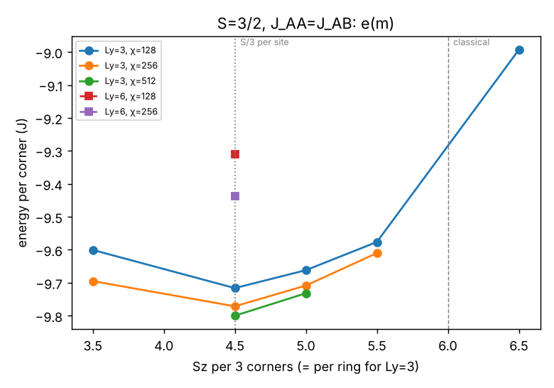
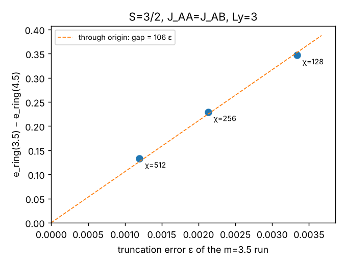
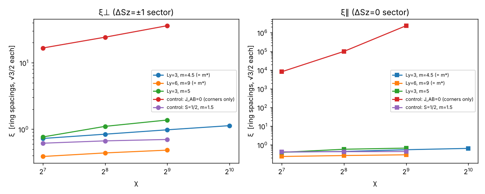
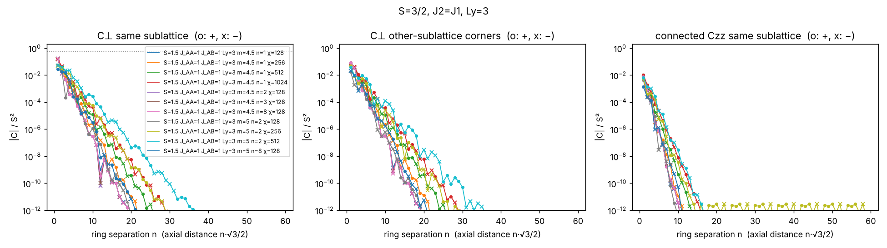
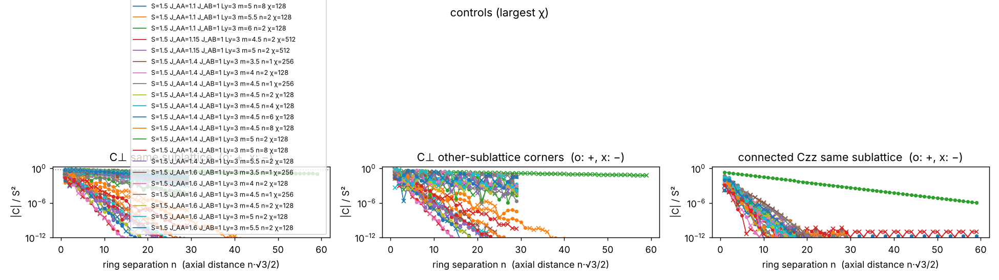
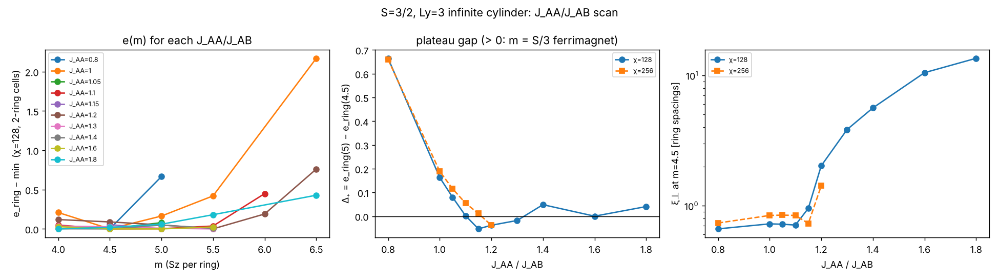

# Triakis 삼각격자 S=3/2 Heisenberg AF — 원통 DMRG 결과 보고서

> 2026-10-23 · 계산 환경: 4코어 / 15 GB 클라우드 컨테이너, TeNPy 1.1.1.
> 주 계산은 Ly=3 무한 원통 χ ≤ 1024, Ly=6 χ ≤ 512, 임계비 스캔 χ ≤ 256. 아래 각 결론의 "신뢰도" 칸에 χ·Ly 한계를 명시했다.

두 의뢰서를 함께 다룬다.
- [`REQUEST.md`](REQUEST.md) (의뢰서 1): 세로 페리자성 위에서 **가로(순 모멘트 축 주위) 3부격자 질서가 있는가**.
- [`BRIEF_ferrimagnet.md`](BRIEF_ferrimagnet.md) (의뢰서 2): 기저상태가 **사이트당 m = S/3 페리자성**인가, 고원 폭, 그리고 페리자성이 무너지는 임계비 (J_AA/J_AB)_c.

표기: J_AA = J1(모서리–모서리), J_AB = J2(모서리–중심), A = 모서리, B = 중심, 단위 J_AB = 1. m = 고리(둘레 한 바퀴)당 S^z; Ly=3에서 고리 = 모서리 3 + 중심 6 = 9스핀이므로 **m = 4.5 ⇔ 사이트당 0.5 = S/3**. 코드 부호 규약은 중심 ⟨Sz⟩ > 0, 모서리 < 0 (브리프와 전역 부호만 반대).

---

## 1. 결론 요약

| 질문 | 결과 | 신뢰도 |
|---|---|---|
| **세로 페리자성** (의뢰서 1) | **유지.** 자발 모멘트 m* = 4.5 = 3S/고리 (사이트당 S/3). 고전값(4S = 6)이 아니라 collinear(Lieb–Mattis) 값으로 양자화되어 있다. | 높음 (Ly=3). 1·2·3고리 셀, 무작위 초기상태, χ=128–1024에서 일관. Ly=6은 m=9 한 섹터만 |
| **가로 3부격자 질서** (의뢰서 1) | **없음 — 가로 부문은 단거리.** 같은 부격자 C⊥(r)는 지수 감쇠하고, 최근접 같은 부격자 값은 **음수**(−0.145 S²)다. 고전 umbrella 값은 +5/9다. ξ⊥ = 0.73 / 0.84 / 0.98 / 1.13 고리 간격(χ = 128/256/512/1024, 격자상수로 1 미만)이고, Ly=6에서는 더 짧다(χ=512에서 0.48). | 중상. ξ⊥는 χ=1024에서도 χ^0.21로 천천히 늘어 완전 포화는 아니다. 같은 파이프라인의 질서 대조군은 χ^0.56이다 (§4.3) |
| 파이프라인의 질서 검출력 | J_AB=0(모서리만의 삼각 AF) 대조에서 ξ⊥ = 16.6 → 24.2 → 36.0, C⊥가 60고리에서도 0.1 S². | 높음 |
| **예측 1** (m = S/3) | **정합** (무한 원통 Ly=3, 1·2·3·8고리 셀). 유한계의 사이트당 m은 토러스 0.611, Lx=6 원통 0.46–0.48, Lx=4 원통 0.400로 0.5를 양쪽에서 낀다(§4.1). | 무한 원통: 높음. 유한 원통의 길이 기울기(고리당 5–5.5)는 끝 효과로 보나 Lx=8로 미확인 |
| **예측 2** (부격자 균일) | **정합.** χ=1024에서 A ⟨Sz⟩ = −0.823, −0.818, −0.818 (산포 0.005), B = +1.160. 연결 S_A(q)는 유계(최대 0.22)이고 Bragg 성분은 Γ뿐이다. | 높음 |
| **예측 3** (고원 폭 > 0.3 J) | **정합.** 고원은 h = 0⁺ ~ h_c2이고 h_c2 = 0.33 / 0.38 / 0.41 J (χ=128/256/512), 외삽 ≈ 0.42 J. m=4.5 위의 e(m)은 m=4.75, 4.83, 5에서 기울기 0.37–0.38로 정확히 선형이다. | 중상 |
| **예측 4** ((J_AA/J_AB)_c > 1) | **방향은 정합, 크기는 경계.** 고원 간격이 닫히는 점은 2고리 셀에서 ≈1.10 (χ=128) → 1.16 (χ=256), 8고리 셀(χ=128)에서 ≈1.08이다. 큰 셀은 J_c를 낮추고 큰 χ는 올린다. 그래서 Ly=3의 참값은 대략 1.1–1.2, 즉 고전 경계보다 0.1–0.2 크다. J_c 바로 위(1.1–1.2)에서는 m=5 섹터가 더 낮아 모먼트가 커지는 쪽으로 고원을 벗어난다. 그 너머(≳1.3)의 상은 미해결이다(§4.5). | 중하. Ly=3·χ≤256(8고리는 χ=128)만, Ly=6 스캔 없음 |

**한 단락 결론 (의뢰서 1의 3.3 판정 기준).**
- S=3/2, J1=J2 triakis 원통에서 세로 페리자성은 유지된다. 다만 순 모멘트는 고전값 4S가 아니라 collinear 값 3S(사이트당 S/3)로 양자화되어 있다.
- 가로 성분에는 3부격자 질서가 없다. 근거는 셋이다. C⊥(r)이 1 격자상수 정도의 길이로 지수 감쇠하고, 같은 부격자 상관의 부호가 umbrella와 반대이며, ξ⊥가 Ly=3→6에서 커지지 않는다.
- ξ⊥는 χ=1024까지 χ 두 배마다 약 16%씩 꾸준히 커져 엄밀한 의미의 포화를 보이지는 않았다. 그래도 같은 파이프라인이 질서를 잡아내는 J_AB=0 대조군(두 배마다 46%, 값 자체가 30배 이상)과는 질적으로 다르다. 판정표 기준으로는 **"가로 부문 양자 무질서"** 행에 해당한다.
- 고전 그림(|L_Δ| = 2S, 비공면, 평탄 zero 띠)에서 기대한 umbrella 가로 질서는 양자 요동으로 사라진다. 대신 의뢰서 2의 order-by-disorder 그림, 즉 A-강자성 collinear 페리자성이 S=3/2 등방점에서 성립한다. A–A는 반강자성 결합인데도 ⟨S_A·S_A⟩ = +0.73 > 0이다.
- 이 고원은 J_AA/J_AB ≈ 1.1–1.2(Ly=3)까지 이어진다. 바로 너머에서는 고전 해 m_cl = 6S − 2S·J_AB/J_AA처럼 모먼트가 커지는 쪽으로 고원을 벗어난다. J_AA/J_AB ≳ 1.3의 상은 단위세포 크기에 민감해 확정하지 못했다.

---

## 2. 검증

### 2.1 18스핀 토러스: DMRG vs ED (의뢰서 3.0, `verification/torus_dmrg.py`)
결합 목록은 의뢰서 표 2.2의 9개 행으로 생성했다(`triakis/model.py`의 `BONDS`, 원통과 **같은 표**). 이 목록은 `ed.py`의 삼각형 기반 독립 구성과 사전 단위로 **완전히 일치**한다: 서로 다른 결합 48개, 세기 합 54, 모서리 배위수 12, 중심 배위수 3.

| S | Sz | E (ED 기준) | E (DMRG) | 차이 |
|---|---|---|---|---|
| 1/2 | 0, 1, 2, 3 | −8.704151 | −8.704151 | < 4e−7 |
| 1/2 | 4 | −8.485800 | −8.485800 | −2e−7 |
| 1/2 | 5 | −7.632865 | −7.632865 | +3e−7 |
| 1 | 10 | −24.165890 | −24.165890 | −3e−7 |
| 1 | 9 | −26.326669 | −26.326669 | −3e−7 |
| 1 | 8 | −27.996179 | −27.996179 | −3e−8 |
| 1 | 7 | −28.372395 | −28.372395 | +2e−7 |
| 3/2 | 9 / 10 / 11 / 12 | (ED 불가) | −58.56267 / −58.56517 / −58.56714 / −57.74011 | trunc 3.6e−5 … 2.3e−7 |

차이는 기준값 반올림 수준이다. 최고 무게 상태 관측량(/S, /S²)도 전부 소수 셋째 자리까지 일치한다.

| 관측량 | S=1/2 ED | S=1/2 DMRG | S=1 ED | S=1 DMRG |
|---|---|---|---|---|
| ⟨Sz⟩ 모서리/S | −0.432 | −0.432 | −0.487 | −0.487 |
| ⟨Sz⟩ 중심/S | +0.716 | +0.716 | +0.827 | +0.827 |
| C⊥ 같은 부격자 | −0.193 | −0.193 | −0.277 | −0.277 |
| C⊥ 최근접 모서리 | +0.070 | +0.070 | −0.012 | −0.012 |
| C⊥ 모서리–중심 | −0.623 | −0.623 | −0.368 | −0.368 |

### 2.2 고전 Ising 검증 (의뢰서 2의 1단계, `verification/ising_check.py`)
σ = ±1로 두고 중심 스핀은 최적으로 배치했다. 토러스 4종(N_A = 6, 9, 16, 16)에서 확인했다.
- J_AA = J_AB: **2^N_A개 배열 전부 E = −3N_A**로, 에너지가 완전히 평탄하다. N_A=16에서는 65536개 중 65536개다.
- J_AB = 1.2 J_AA: 최소 상태 축퇴는 **2**(A-강자성과 그 시간반전).

### 2.3 원통·유한 원통 구현
- 무한 원통 모델: 고리당 Sz–Sz 항 27개(단위세포 결합 9개 × 3), 모서리 배위수 12, 중심 3. MPO 결합 차원은 Ly=3에서 23–35, Ly=6에서 50–62.
- 유한 열린 원통(`triakis/finite_cyl.py`, 완전한 삼각형에만 중심을 둠): S=1/2, Lx=3(21스핀) ED로 확인했다. J_AA=0일 때 E(0.5) = E(1.5) < E(2.5)이므로 **S_tot = 1.5 = S(N_B−N_A)**이고, Lieb–Mattis 값을 그대로 재현한다(`verification/finite_cyl_ed_check.txt`).

---

## 3. 방법

- **알고리즘:** TeNPy, `SpinSite(S, conserve='Sz')`, 2-site iDMRG + density-matrix mixer.
- **원통:** 둘레 = Ly·a1 (Ly = 3, 6, 3부격자와 호환), 길이 방향 = a2. MPS 순서는 고리마다 x = 0, 1, …에 대해 (모서리, 위 중심, 아래 중심)이다.
- **자화 섹터:** U(1)로 단위세포 S^z를 고정한다. 단위세포 고리 수 n은 1, 2, 3, 4를 썼다. m = 4.75는 4고리, m = 4.833은 3고리 셀이다.
- **χ 스케줄:** χ = 128 → 256 → 512 → 1024, 이전 χ 상태에서 이어서 계산했다.
  - 실행마다 χ ≤ 512는 70 sweep, χ=1024는 30 sweep을 돌았다(로그의 `finished after N sweeps`).
  - 대부분 ΔE/sweep < 1e−9 기준에 도달하기 전에 **최대 sweep 수에서 끊겼다**(`Maximum number of sweeps reached`).
  - `data/summary.jsonl`의 `sweeps` 필드는 sweep 수가 아니라 체크포인트 기록 수(10 sweep마다 1회)다. `dE_last`는 마지막 두 체크포인트, 즉 10 sweep 간 에너지 차이다.
  - 특히 χ=1024(m=4.5)는 dE_last = 9.5e−7로, χ=256 같은 섹터의 3.4e−10보다 네 자릿수 크다. 에너지 자체는 절단오차 1.4e−4 수준에서 신뢰할 만하다.
  - 그러나 전송행렬 스펙트럼(ξ⊥)은 에너지보다 수렴이 느리다. 이 실행은 χ=512 상태(ξ⊥ = 0.98)에서 출발했고 ξ⊥는 χ와 함께 단조 증가해 왔다. 따라서 χ=1024의 ξ⊥ = 1.13은 최종값보다 **작을(과소평가) 가능성**이 크다. 같은 상태를 100 sweep으로 연장하는 계산이 진행 중이다.
- **관측량:**
  - 부격자별 ⟨Sz⟩
  - 전하 섹터별 전송행렬 스펙트럼: ΔSz=0 → ξ∥, ΔSz=±1 → ξ⊥, ΔSz=±2. 길이 단위는 **고리 간격**(축 방향 √3/2)이다.
  - C⊥(r) = ½⟨S⁺S⁻ + S⁻S⁺⟩와 연결 Czz(r): 고리 0의 모서리를 기준으로 최대 60고리까지
  - 고리 경계 얽힘 엔트로피, 결합 에너지 ⟨S_i·S_j⟩, A 연결 구조인자 S_A(q)
- **함정 두 가지:**
  1. m = 5.5와 6.5를 1고리 셀로 돌리면 iDMRG가 두 상태 사이를 진동하며 수렴하지 않는다. 그래서 2고리 셀로 다시 계산했다.
  2. **J_AA/J_AB ≳ 1.1에서는 단위세포 크기에 따라 에너지가 크게 달라진다.**
     - 1고리 셀은 같은 m에서 2고리 셀보다 0.16–0.69/고리 높다. 처음에는 1고리 셀의 e(3.5) < e(4.5)를 보고 "J_AA = 1.4에서 붕괴"로 잘못 판정했고, 이를 철회한 뒤 스캔 전체를 2고리 셀로 다시 계산했다.
     - 8고리 셀은 J_AA = 1.1–1.4에서 2고리 셀보다 다시 0.05–0.09/고리 낮다. 4·6고리 셀은 J_AA = 1.4에서 오히려 높게 나와(국소 최소) 주기를 단정할 수 없다.
     - **J_AA = J_AB에서는 1·2·3·8고리 셀의 m=4.5가 −29.1487 / −29.1488 / −29.1489 / −29.1490으로 일치한다.** 따라서 주 결과는 셀 크기에 영향받지 않는다.

---

## 4. 결과

전체 표는 [`results/table.md`](results/table.md)(CSV: `results/table.csv`)에 있다. 원자료는 `data/summary.jsonl`, `data/<tag>/chi*.npz`, 유한 원통은 `data/finite_results.jsonl`이다.

### 4.1 자발 모멘트 m*: e(m) (S=3/2, J_AA = J_AB, Ly=3)



| m (고리당) | 셀 | χ=128 | χ=256 | χ=512 | χ=1024 (30 sweep, 미수렴) | 비고 |
|---|---|---|---|---|---|---|
| 3.5 | 1 | −9.60056 | −9.69504 | −9.75556 | | 4.5와의 차이가 χ와 함께 0으로 감소 |
| 4 | 2 | −9.64683 | | | | |
| **4.5** | 1 (2, 3) | **−9.71625** | **−9.77150** | **−9.79993** | **−9.81206** | 외삽 −9.819 |
| 4.75 | 4 | −9.68998 | −9.74049 | | | |
| 4.833 | 3 | −9.68006 | −9.72976 | | | |
| 5 | 2 (8) | −9.66192 (8고리 −9.66676) | −9.70852 | −9.73198 | | 외삽 −9.75; 무작위 초기 −9.66188 |
| 5.5 | 2 | −9.57645 | −9.61009 | | | 무작위 초기 −9.57609 |
| 6.5 | 2 | −8.99325 | | | | ξ∥ ≈ 1700 (고원 위 gapless) |

값은 모서리당 에너지(= 고리당 / 3)다. 고전 바닥 에너지는 모서리당 −7.875다.

- **m > 4.5는 확실히 높다.**
  - e(m) − e(4.5)는 고리당 m = 4.75 / 4.833 / 5에서 0.093 / 0.125 / 0.189 (χ=256)이다. 기울기 0.37–0.38로 정확히 선형이어서 4.5와 5 사이에 평탄 구간이 없다. 즉 모멘트는 양자화되어 있다.
  - e(5) − e(4.5)는 χ = 128 / 256 / 512에서 0.163 / 0.188 / 0.204이고, 절단오차 외삽 ≈ 0.21이다.
  - 무작위 초기상태도 같은 값으로 수렴하므로 준안정 상태에 갇힌 것이 아니다.
  - 8고리 셀(χ=128)에서도 m=4.5는 −29.1490/고리로 변하지 않는다. m=5는 −29.0003으로 2고리보다 0.015 내려가지만, 여전히 m=4.5보다 0.149 높다. J_AA = 1.1–1.4에서 큰 셀이 판정을 바꾼 것(§4.5)과 달리 J_AA = J_AB의 m* = 4.5는 셀 크기에 견고하다. 다만 h_c2는 8고리 χ=128에서 0.30 J로, 2고리(0.33 J)보다 약간 낮다.
- **m < 4.5는 평탄으로 수렴한다.**
  - m ≤ m*이면 이론적으로 e(m)은 평탄해야 한다(기울어진 페리 다중항). 유한 χ에서는 위로 편향된다.
  - 편향의 크기는 χ가 아니라 **절단오차 ε에 선형**으로 보는 것이 자연스럽다. m=3.5는 기울어진 상태라 무갭 골드스톤 모드를 품고 있고, 그 모드가 버리는 가중치가 곧 ε이므로 에너지 편향이 ε에 비례한다. χ에 대한 단순 거듭제곱을 기대할 이유는 없다(실제로 χ 두 배당 비는 0.661, 0.580으로 일정하지 않다).

  | χ | e_ring(3.5) − e_ring(4.5) | ε(m=3.5) | 간격/ε |
  |---|---|---|---|
  | 128 | 0.3471 | 3.34e−3 | 104.0 |
  | 256 | 0.2294 | 2.13e−3 | 107.7 |
  | 512 | 0.1331 | 1.20e−3 | 111.2 |

  

  - 비례상수가 세 점에서 7% 안에 머문다. 즉 간격 ≈ 106 ε로 **원점을 지나는 직선**에 가깝고, ε → 0에서 간격 → 0이다. χ 외삽 없이 m=3.5가 m=4.5와 축퇴임을 읽을 수 있다.
  - 비가 104 → 111로 단조 증가하므로 절편을 자유롭게 둔 직선 맞춤도 확인했다. 결과는 절편 = +0.013/고리다. 고원 위 간격 Δ₊ ≈ 0.2의 6%로, 0과 구분되지 않는 크기다.
- **유한계와의 차이 (해소).** 사이트당으로 환산하면, 반대 방향의 인공물을 갖는 두 유한계가 무한 원통 값을 양쪽에서 낀다.

  | 계 | S_tot | 사이트 수 | 사이트당 m |
  |---|---|---|---|
  | 18스핀 토러스 | 11 (E(9)≈E(10)≈E(11) < E(12)) | 18 | 0.611 |
  | **무한 원통 Ly=3** | — | — | **0.500** |
  | 유한 원통 Lx=4 | **12** (E(Sz=9…13, 15) = −91.941, −91.994, −91.966, **−92.011**, −91.473, −90.853) | 30 (A 12 + B 18) | **0.400** |
  | 유한 원통 Lx=6 | **22 또는 23** (E(22) −150.346, E(24) −149.837, E(26) −148.826; Sz=23 계산 중) | 48 (A 18 + B 30) | **0.458–0.479** |
  | Lieb 값 S(N_B−N_A), Lx=4 / Lx=6 | 9 / 18 | 30 / 48 | 0.300 / 0.375 |

  - 토러스는 모서리–모서리 결합 6개가 중복(J=2)되어 A–A를 과대평가한다. §4.5에서 J_AA가 커지면 모멘트가 커지므로 위로 치우치는 것이 자연스럽다.
  - Lx=4 원통은 N_B/N_A = 1.5로 벌크 비 2.0에서 크게 벗어난, 경계가 지배하는 클러스터라 아래로 치우칠 것으로 예상된다.
  - Lx=4에서는 E(12)가 가장 낮고 E(13)은 0.54 높다. 따라서 S_tot = 12, 사이트당 0.400 < 0.5이고, 토러스(0.611)와 함께 무한 원통 값 0.5를 양쪽에서 낀다.
  - 정확한 이론에서는 Sz = 9–12 섹터가 축퇴해야 한다. Sz가 낮을수록 최대 0.07 높게 나오는 것은 큰 섹터에서 DMRG 수렴이 나쁘기 때문이다(χ=512, 절단오차 4–9×10⁻⁴). 인공물의 방향이 서로 반대이고 무한 원통 값이 그 사이에 들어온다는 점은 m* = 4.5의 보강 증거다.
  - Lx = 4 → 6에서 사이트당 m이 0.400 → 0.46–0.48로 0.5를 향해 올라간다.
  - **남은 긴장:** Lx = 4 → 6의 S_tot 증가분(10–11, 고리당 5–5.5)은 무한 원통 m* = 4.5보다 크다. 사이트당 값이 아래에서 0.5로 다가가는 과정에서 끝 효과가 줄어드는 몫으로 해석할 수 있다. 하지만 Lx = 8 이상으로 기울기가 4.5로 내려가는지는 확인하지 못했다(48사이트 χ=512에서 섹터당 1–2시간).
  - 같은 토러스에서 S=1/2와 S=1의 S_tot은 각각 3과 7(3S, 3.5S)이다.

### 4.2 부격자 모먼트·결합 에너지 (m* 섹터)

| | Ly=3 χ=512 | Ly=3 χ=1024 | Ly=6 χ=512 |
|---|---|---|---|
| ⟨Sz⟩ 모서리 A, B, C | −0.842, −0.826, −0.826 | −0.823, −0.818, −0.818 (30 sweep) | −1.009, −0.911, −0.912 |
| ⟨Sz⟩ 위/아래 중심 | 1.166 | 1.160 | 1.222 |
| ⟨S·S⟩ A–A | +0.760 | +0.725 | +1.121 |
| ⟨S·S⟩ A–B | −2.012 | −2.000 | −2.074 |
| 고리 경계 얽힘 엔트로피 | 2.53 | 2.61 | 3.45 |
| 절단오차 | 3.9e−4 | 1.4e−4 | 1.3e−3 |

- 검산: 3⟨AA⟩ + 6⟨AB⟩ = −9.82로, iDMRG 값 −9.812(χ=1024)와 맞는다.
- A–A는 반강자성 결합인데 상관은 강자성적이다. 이것이 A-강자성 collinear 페리자성이다.
- 모먼트 크기: 모서리 |⟨Sz⟩|/S = 0.55, 중심 0.77.
- Ly=6 값은 수렴이 덜 된 상태(고전 곱상태 쪽으로 치우침)라 정량 비교용이 아니다.
- A 연결 구조인자(χ=1024): S_A(Γ) = −0.27, S_A(K) = 0.22, S_A(M) = −0.17. 최대 0.22로 유계이고 발산하는 피크가 없다.

### 4.3 가로 상관 (의뢰서 1의 핵심 질문)




| 경우 | χ=128 | χ=256 | χ=512 | χ=1024 (30 sweep, 미수렴) | ξ ∝ χ^κ |
|---|---|---|---|---|---|
| ξ⊥, Ly=3, m=4.5 | 0.73 | 0.84 | 0.98 | 1.13 | κ = 0.21 |
| ξ∥, Ly=3, m=4.5 | 0.41 | 0.44 | 0.55 | 0.64 | |
| ξ⊥, Ly=6, m=9 | 0.39 | 0.44 | 0.48 | | |
| ξ⊥, Ly=3, m=5 | 0.76 | 1.10 | 1.37 | | |
| **대조**: ξ⊥, J_AB=0 | 16.6 | 24.2 | 36.0 | | κ = 0.56 |
| 대조: ξ⊥, S=1/2 | 0.62 | 0.67 | 0.70 | | |

- **같은 부격자 C⊥/S²** (고리 거리 n = 1..5, Ly=3, χ=1024): −0.145, −0.044, +0.020, +0.003, −0.003. 대략 고리 하나마다 반 자릿수씩 감쇠해 20고리에서 10⁻¹²에 이른다. 고전 umbrella 값 +0.56과는 크기도 부호도 다르다. 다른 부격자 모서리와 연결 Czz도 같은 속도로 감쇠한다.
- **ξ⊥의 χ 의존성:** χ=1024까지 κ ≈ 0.21로 꾸준히 커져 엄밀한 포화는 보이지 않는다.
  - 다만 임계(무간격) 상태라면 κ = 6/[c(√(12/c)+1)] 관계를 역산할 때 **κ = 0.21 → c ≈ 15**(κ = 0.214에서 14.7)로, 비현실적으로 큰 중심전하가 필요하다. 반면 같은 파이프라인의 질서 대조군은 **κ = 0.56 → c ≈ 3.9**로, Ly=3 원통의 질서상에 걸맞은 값이다. 즉 두 경우는 κ의 크기뿐 아니라 물리적으로 가능한 c인지에서도 갈린다. 그래서 수렴이 느린 짧은 상관길이일 가능성이 높다.
  - 크기 자체도 1 고리 간격 정도에 머문다. 같은 파이프라인의 질서 대조군(κ = 0.56, ξ⊥ 30배 이상)과 질적으로 구분된다.
- **Ly 의존성:** Ly=6(χ=512)에서 ξ⊥ = 0.48, 같은 부격자 C⊥(n=1) = −0.076 S²다. Ly를 키워도 가로 상관은 커지지 않는다. 다만 같은 χ에서 Ly=6은 덜 수렴했다(절단오차 1.3×10⁻³). 그래서 이 부분은 보조 증거다.

### 4.4 대조 실험 (Ly=3)



| 계 | 섹터 | χ | e/모서리 | 절단오차 | ⟨Sz⟩ 모서리 | ξ⊥ | 해석 |
|---|---|---|---|---|---|---|---|
| S=1/2 | m=1.5 (=3S) | 512 | −1.494715 | 1.5e−7 | −0.225 (균일) | 0.70 | 가로 무질서, ED와 정합 |
| S=1 | m=3.5 (2고리) | 256 | −4.674228 | 2.1e−4 | −0.572, −0.424, −0.572 | 1.52 | 가로 무질서 |
| S=3/2, J_AB=2 | m=4.5 | 256 | −23.619237 | 1.1e−5 | −1.239 (균일) | 0.53 | collinear 페리, 가로 ≈ 0 (예상대로) |
| S=3/2, J_AB=0 (모서리만) | m=0 | 512 | −3.927648 | 6.1e−5 | 0 | **36.0** | 120° 질서 신호, 파이프라인이 질서를 검출 |

### 4.5 임계비 (J_AA/J_AB)_c (의뢰서 2의 4단계, Ly=3, 2고리·8고리 셀)

판정량은 고원 간격 Δ₊ = e_ring(5) − e_ring(4.5)이다. Δ₊ > 0이면 m = S/3 고원이 있다.



| J_AA/J_AB | Δ₊ 2고리 χ=128 | Δ₊ 2고리 χ=256 | Δ₊ 2고리 χ=512 | **Δ₊ 8고리 χ=128** | ξ⊥(m=4.5): 2고리 / 8고리 (χ=128) | 최저 섹터 (2고리 χ=128) |
|---|---|---|---|---|---|---|
| 0.8 | +0.665 | +0.659 | | | 0.7 | 4.5 |
| 1.0 | +0.163 | +0.188 | +0.204 | **+0.149** | 0.7 / 0.7 | 4.5 |
| 1.05 | +0.079 | +0.115 | | | 0.7 | 4.5 |
| 1.10 | +0.002 | +0.055 | | **−0.045** | 0.7 / 0.7 | 4.5 ≈ 5 |
| 1.15 | −0.054 | +0.011 | +0.037 | | 1.0 | 5 |
| 1.20 | −0.038 | −0.038 | | **−0.055** | 2.0 / 0.8 | **5.5** (e(6) = +0.19, e(6.5) = +0.76 위) |
| 1.3 † | −0.018 | | | | 3.8 | 5.5 |
| 1.4 † | +0.048 | | | **+0.027** | 5.6 / 0.9 | 4–5.5 거의 평탄 |
| 1.6 † | 0.000 | | | | 10.5 | 4.5–5 |
| 1.8 † | +0.041 | | | | 13.5 | 4–4.5 |

J_AA = 1.0의 χ=512 값은 2고리 m=5와 1고리 m=4.5의 차이다(셀 일치는 §3). † 셀 수렴 미확인.

- **8고리 셀의 영향:**
  - J_AA = 1.0에서는 m=4.5가 변하지 않고(−29.1490) m=5만 0.015 내려가, Δ₊가 0.163 → 0.149로 조금 줄어든다. 고원과 m* = 4.5는 유지된다.
  - J_AA = 1.1에서는 m=5가 0.047 내려가 Δ₊가 +0.002 → −0.045로 부호가 바뀐다.
  - J_AA = 1.2·1.4에서는 두 섹터가 함께 0.05–0.09 내려간다.
  - 2고리 셀에서 보인 긴 ξ⊥(J_AA = 1.2–1.8에서 2–14)는 8고리 셀에서 0.8–0.9로 줄었다. **작은 셀이 만든 인공물이었다.**

- **셀 수렴에 대한 정정:** 이전 판에서는 "임계 구간의 ξ⊥가 2고리 셀보다 짧으므로 셀이 주기를 강제하지 않는다"고 썼다. 그러나 그 ξ⊥ 자체가 2고리 셀에서 잰 값이었고, 8고리 셀이 J_AA = 1.1·1.2의 m=5를 0.05–0.08 더 내렸다. 이 논리는 성립하지 않는다.
  - J_c는 셀 크기에 대해 아직 수렴하지 않았다.
  - 아래쪽 가장자리: J_AA = 1.1, χ=128, 2고리에서 e_ring(4.0) = −28.4091 > e_ring(4.5) = −28.4570이다. 유한 χ 편향과 같은 방향이라 보조 증거다.

- **(J_AA/J_AB)_c:** 2고리 셀에서 ≈1.10(χ=128), ≈1.16(χ=256)이다. J_AA = 1.15에서 Δ₊가 −0.054 → +0.011 → +0.037(χ = 128 → 256 → 512)로 커진다.
  - 8고리 셀(χ=128)에서는 Δ₊(1.0) = +0.149, Δ₊(1.1) = −0.045를 선형 보간해 ≈1.08이다.
  - 큰 χ는 J_c를 올리고 큰 셀은 내린다. 두 효과를 합치면 Ly=3의 참값은 대략 **1.1–1.2**로 본다. 8고리 χ=256(J_AA = 1.0, 1.1)을 계산 중이다.
- **예측 4와 비교:** 고전 경계 1보다 0.1–0.2 크다. "1보다 크다"는 방향은 정합하고, 크기는 예측 범위(0.1–0.5)의 아래쪽 경계에 걸친다.
- **고원을 벗어나는 방향:** 모먼트가 **감소가 아니라 증가**하는 쪽이다. 고전 Heisenberg 해는 삼각형당 E = (J_AA/4)(L² − 3S²) − J_AB·S·|L|를 최소화해 |L| = 2S·J_AB/J_AA이고, 고리당 m_cl = 6S − 2S·J_AB/J_AA다. J_AA/J_AB = 1.2에서 m_cl = 6.5이므로 DMRG의 5.5와 같은 방향이다. 양자 계에서는 J_AA ≈ J_AB 근방에서 m이 3S로 고정되어 고원을 이루고, 임계비를 넘으면 고전 쪽으로 풀린다.
- **임계비 너머의 상 (미해결):**
  - 이전 판의 서술(2고리 주기, 긴 ξ⊥ 2–14, 모서리 120° 성향)은 **철회한다.**
  - J_AA = 1.4, m=4.5, χ=128의 셀별 에너지는 2고리 −28.3874, 4고리 −28.3508, 6고리 −28.3422, **8고리 −28.4735**다. 8고리가 0.086 낮고 ξ⊥ = 0.94로 짧다. 4·6고리가 높게 나온 것은 국소 최소이거나 주기가 맞지 않기 때문으로 보인다.
  - 8고리 셀에서도 Δ₊(1.4) = +0.027 > 0이라, J_AA = 1.1–1.2(Δ₊ < 0)와 달리 m=4.5가 다시 m=5보다 낮다. Δ₊(J)가 단조롭지 않다.
  - J_AA ≳ 1.3의 상(모먼트, 주기, 가로 상관)은 χ = 128, 셀 ≤ 8고리로는 확정할 수 없다. J_AA = 1.4, 8고리 m=4를 계산 중이다.
- **판정의 한계:** 판정은 변분 상한끼리의 비교다. 각 J에서 m=4.5와 5를 같은 셀(2고리 또는 8고리)로 비교했다.
  - J_AA = 0.8과 1.0 행의 Δ₊는 e_ring(5, 2고리) − e_ring(4.5, 1고리)로, 셀이 섞여 있다.
  - J_AA = 1.0에서는 1·2·3고리 셀 에너지가 모서리당 5e−5(고리당 1.3e−4) 안에서 일치한다(§3). Δ₊ = 0.16–0.19에 비해 무시할 수 있다.
  - J_AA = 0.8에서도 2고리 셀 m=4.5가 −31.1485 / −31.2055(χ=128 / 256)로 1고리 셀과 10⁻⁴ 안에서 일치한다. 따라서 0.8 행의 Δ₊에도 영향이 없다.

### 4.6 고원 폭 (예측 3)
섹터 에너지를 르장드르 변환하면, m = 4.5 고원은 h = 0⁺(자발 모멘트)에서 h_c2 = 기울기 de_ring/dm|₄.₅⁺까지다.

| χ | 128 | 256 | 512 | 외삽 |
|---|---|---|---|---|
| h_c2 / J ([e(5) − e(4.5)]/0.5) | 0.33 | 0.38 | 0.41 | ≈ 0.42 |
| h_c2 / J (m = 4.75, 4.83에서의 기울기, χ=256) | | 0.37 | | |

고원 폭은 0.3 J보다 넓다(예측 3 정합). 고원 위로는 m = 5, 5.5, 6.5로 갈수록 에너지가 계속 오르고, m = 6.5에서 ξ∥ ≈ 1700이다(고원 위의 gapless 마그논 영역). J_AA/J_AB = 0.8에서는 h_c2 ≈ 1.3 J로 더 넓다.

---

## 5. 한계

- **χ:** 4코어·15 GB 머신이라 의뢰서의 χ = 2048, 브리프의 3000–5000은 불가능했다. Ly=3은 χ=1024(절단오차 1.4×10⁻⁴)까지 갔다. Ly=6은 χ=512까지이고 절단오차가 1.3×10⁻³이라 에너지 외삽이 의미가 없다. 그래서 Ly=6은 정성적 비교(ξ⊥가 Ly와 함께 커지지 않음)에만 썼다.
- **ξ⊥ 미포화:** χ=1024에서도 χ^0.21로 증가한다. "단거리"라는 결론은 크기(≈1 격자상수), 부호, 대조군과의 비교, Ly 의존성을 근거로 한다.
- **유한계 S_tot:** 유한 클러스터 두 종류가 무한 원통 값을 양쪽에서 낀다. 사이트당 m은 18스핀 토러스 0.611, 무한 원통 0.500, Lx=4 유한 원통 0.400(S_tot = 12)이다(§4.1 표).
  - 토러스는 중복된 A–A 결합 때문에 위로, Lx=4는 N_B/N_A = 1.5인 경계 지배 클러스터라 아래로 치우친다.
  - 다만 Lx=6 이상에서 사이트당 m이 0.5로 수렴하는 추세는 확인하지 못했다(수렴 비용, 계산 중).
- **임계비:** Ly=3, 2고리 셀 χ ≤ 512(J_AA = 1.15), 8고리 셀 χ=128뿐이다. J_c는 셀 크기와 χ 양쪽에 대해 아직 수렴하지 않았다(1.1–1.2). J_AA ≳ 1.3의 상은 미해결이고, Ly=6 스캔은 미실시다.
- **선택 항목:** 스칼라 키랄성은 실수 MPS·U(1) 고정 섹터에서 자명하게 0이라 측정하지 않았다. 3고리 셀 시험(병진 깨짐 없음)은 완료했다.
- **설계 차이:** 브리프의 유한 원통(Lx ≥ 24, 양끝 3열 제외) 대신 주 계산은 **무한 원통 iDMRG**로 했다(경계 없음). 장(h) 스윕은 섹터 에너지의 르장드르 변환으로 대신했다(브리프 3단계 방식).

---

## 6. 재현

```bash
pip install physics-tenpy scipy matplotlib
# 검증
cd verification && python3 ed.py 1 0 2 4 6 8 10 && python3 obs.py 1 6
python3 torus_dmrg.py 1 0 2 4 6 8 10 --chi 512
python3 torus_dmrg.py 2 20 18 16 14 --chi 1500
python3 torus_dmrg.py 3 18 20 22 24 --chi 1200
python3 ising_check.py
cd ..
# 주 계산 (예)
python3 -m triakis.run_idmrg --S 1.5 --Ly 3 --m 4.5 --chis 128 256 512
python3 -m triakis.run_idmrg --S 1.5 --Ly 3 --m 4.5 --restart --chis 1024 --max_sweeps 30
python3 -m triakis.run_idmrg --S 1.5 --Ly 3 --m 4.75 --nring 4 --chis 128 256
python3 -m triakis.run_idmrg --S 1.5 --Ly 6 --m 9 --chis 128 256 512
python3 -m triakis.run_idmrg --S 1.5 --J1 1.1 --m 5 --nring 2 --chis 128 256     # 임계비 스캔
python3 -m triakis.run_idmrg --S 1.5 --J2 0 --nocenters --m 0 --chis 128 256 512 # 대조
python3 -m triakis.finite_cyl --Lx 4 --Sz 9 11 --chi 512                          # 유한 원통
# 표·그림
python3 -m triakis.analyze
```

| 파일 | 내용 |
|---|---|
| `triakis/model.py` | 결합 표(의뢰서 2.2), 원통 격자·모델, 토러스 결합 생성 |
| `triakis/run_idmrg.py` | iDMRG 드라이버와 관측량(섹터별 전송행렬, C⊥, Czz, 얽힘) |
| `triakis/finite_cyl.py` | 유한 열린 원통 E(S^z_tot) 스캔 |
| `triakis/analyze.py` | 표(`results/`), 그림(`figs/`), 결합 에너지, S_A(q), 임계비 스캔 |
| `verification/` | ED(첨부), 토러스 DMRG, Ising 검증, 유한 원통 ED 검사 |
| `queue.py`, `launch.sh`, `jobs_*.txt` | 이 머신에서 쓴 작업 큐 |
